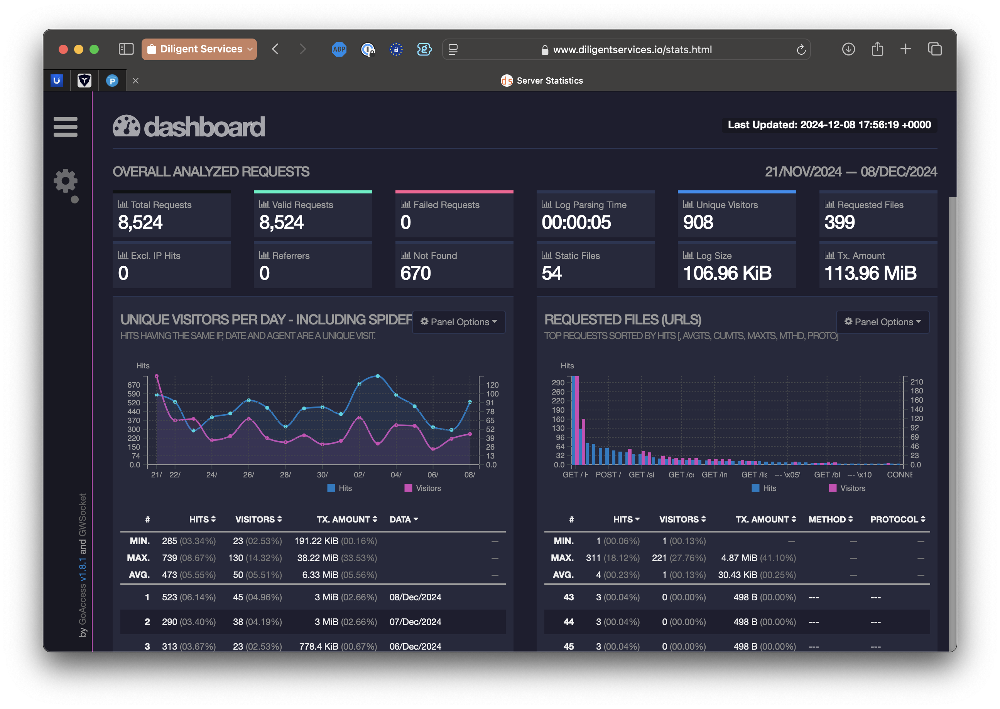

## Overview


::: {.callout-note title="Updated July 16, 2026"}
This post originally ran in December 2024, and the recipe in it had four bugs. I found all four the hard way when I went looking for this site's stats page and it was gone. What follows is the corrected version, and it matches the config running on this site right now.
:::

GoAccess is a lightweight, server-based web analytics tool that processes server logs to provide real-time visitor insights. No JavaScript snippet, no third-party service, no cookie banner. Your nginx logs already have the data; GoAccess turns them into a dashboard.

Out of the box it forgets everything across log rotations, so the goal here is a setup that keeps cumulative history, updates in real time over HTTPS, restarts itself when logs rotate, and survives a site deploy. That last one matters more than you'd think for a Quarto site.

Where needed, I'll note the spots you should customize for your own server (directories, log paths, domain).

---

## What the 2024 version got wrong

If you followed the original post, here's what eventually bit me, and will bite you:

1. **The report lived inside `_site/`.** Quarto rebuilds `_site` from scratch on every render, which means every deploy deleted `stats.html`. The dashboard would work until the next time I published a post, then quietly vanish.
2. **The database went to `/tmp`.** The service used `--persist --restore` and never passed `--db-path`, so GoAccess dropped its database in `/tmp`, where it died on the first reboot. The original post even created `/var/lib/goaccess` and then never told GoAccess to use it.
3. **The real-time WebSocket used plain `ws://` on an open port.** Browsers block insecure WebSocket connections from an HTTPS page as mixed content, so the "real-time" part never worked, and I had port 7890 open to the world for nothing.
4. **The logrotate snippet was invalid.** It appended a `postrotate` block *after* the closing brace in `/etc/logrotate.d/nginx`. Directives outside the `{ }` stanza don't count, so GoAccess never restarted on rotation.

Every fix is below, in place.

---

## Step 1: Install or Verify GoAccess

First, ensure GoAccess is installed. If it's already installed, this step will skip installation.

```sh
if ! command -v goaccess &> /dev/null; then
  sudo apt update && sudo apt install -y goaccess
else
  echo "GoAccess is already installed."
fi
```

---

## Step 2: Create the Database and Report Directories

GoAccess keeps its historical data in an on-disk database. Give it a real home so it survives reboots:

```sh
DB_PATH="/var/lib/goaccess"
if [ ! -d "$DB_PATH" ]; then
  sudo mkdir -p "$DB_PATH"
  sudo chown -R www-data:www-data "$DB_PATH"
  echo "GoAccess database directory created."
else
  echo "GoAccess database directory already exists."
fi
```

The report needs its own home too, and this is the fix for bug #1: it must live **outside** your Quarto render tree. Anything in `_site/` gets wiped on every render, so write the report somewhere Quarto can't touch and let nginx serve it from there:

```sh
REPORT_DIR="/var/www/goaccess"
if [ ! -d "$REPORT_DIR" ]; then
  sudo mkdir -p "$REPORT_DIR"
  sudo chown -R www-data:www-data "$REPORT_DIR"
  echo "GoAccess report directory created."
else
  echo "GoAccess report directory already exists."
fi
```

---

## Step 3: The Systemd Service

This service fixes bugs #2 and #3. It passes `--db-path` so persistence actually persists, binds the WebSocket server to localhost only, and tells the browser to connect back over `wss://` on port 443 (we'll wire that through nginx in the next step). Replace `yourdomain.com` with your domain.

```sh
SERVICE_FILE="/etc/systemd/system/goaccess.service"
sudo tee "$SERVICE_FILE" > /dev/null <<EOF
[Unit]
Description=GoAccess Real-Time Web Analytics Service
After=network.target
Wants=network-online.target

[Service]
User=www-data
Group=www-data
ExecStart=/usr/bin/goaccess /var/log/nginx/access.log \\
  --log-format=COMBINED \\
  --persist --restore --db-path=/var/lib/goaccess \\
  -o /var/www/goaccess/index.html \\
  --real-time-html \\
  --addr=127.0.0.1 --port=7890 \\
  --ws-url=wss://yourdomain.com:443/stats.ws
Restart=on-failure
RestartSec=5

[Install]
WantedBy=multi-user.target
EOF

sudo systemctl daemon-reload
sudo systemctl enable goaccess
sudo systemctl restart goaccess
```

A few things worth calling out:

- **`--db-path=/var/lib/goaccess`** is the line the 2024 version was missing. Without it, `--persist` writes to `/tmp` and your history evaporates on reboot.
- **`--addr=127.0.0.1`** keeps the WebSocket server off the public internet entirely. No firewall rule needed. If you followed the old post, close the hole: `sudo ufw delete allow 7890/tcp`.
- **`--ws-url=wss://yourdomain.com:443/stats.ws`** is what the generated report tells the browser to connect to. Secure WebSocket, standard HTTPS port, proxied by nginx. This is what makes real-time updates work on an HTTPS site.
- If GoAccess can't read the log, check the log file's group. On Debian and Ubuntu, nginx logs are typically owned `root:adm`, so either add your service user to the `adm` group or adjust to fit your setup.

---

## Step 4: Wire It Through nginx

Two locations in your site's server block: one serves the report at `/stats.html`, the other proxies the WebSocket at `/stats.ws` to the localhost port GoAccess is listening on.

I also put both behind basic auth. The report includes visitor IP addresses, and that has no business being world-readable. Create the credentials first:

```sh
sudo apt install -y apache2-utils
sudo htpasswd -c /etc/nginx/.htpasswd-stats yourname
```

(The `-c` creates the file; drop it when adding more users later.)

Then add these inside the `server { }` block for your site, in `/etc/nginx/sites-available/yoursite`:

```nginx
location = /stats.html {
    alias /var/www/goaccess/index.html;
    add_header Cache-Control "no-store, no-cache, must-revalidate, max-age=0";
    auth_basic "Stats";
    auth_basic_user_file /etc/nginx/.htpasswd-stats;
}

location = /stats.ws {
    proxy_pass http://127.0.0.1:7890;
    proxy_http_version 1.1;
    proxy_set_header Upgrade $http_upgrade;
    proxy_set_header Connection "upgrade";
    proxy_set_header Host $host;
    proxy_read_timeout 7d;
    auth_basic "Stats";
    auth_basic_user_file /etc/nginx/.htpasswd-stats;
}
```

Test and reload:

```sh
sudo nginx -t && sudo systemctl reload nginx
```

The `alias` is what decouples the report from your Quarto site. The URL still looks like part of the site, but the file lives in `/var/www/goaccess/`, where `quarto render` can never delete it. The `Upgrade` and `Connection` headers are what let nginx pass the WebSocket handshake through; without them the proxy speaks plain HTTP and the connection dies.

---

## Step 5: Fix Log Rotation Properly

When logrotate rotates `access.log`, GoAccess needs a restart to pick up the new file. The 2024 version appended a `postrotate` block to the end of `/etc/logrotate.d/nginx`, outside the existing `{ }` stanza. That's invalid syntax; logrotate only honors directives inside the braces, so the restart never ran.

The correct fix is a one-line edit by hand. Open `/etc/logrotate.d/nginx` and add the restart *inside* the existing `postrotate` block:

```
/var/log/nginx/*.log {
        daily
        missingok
        rotate 14
        compress
        delaycompress
        notifempty
        create 0640 www-data adm
        sharedscripts
        postrotate
                invoke-rc.d nginx rotate >/dev/null 2>&1
                systemctl try-restart goaccess
        endscript
}
```

Your existing file will differ in the details; the only change is the `systemctl try-restart goaccess` line. I use `try-restart` rather than `restart` so rotation only restarts GoAccess if it's already running, and a deliberately stopped service stays stopped.

Validate without actually rotating anything:

```sh
sudo logrotate -d /etc/logrotate.d/nginx
```

---

## Step 6: Seed History from Rotated Logs

A fresh install starts counting from today, but your server has been logging for weeks. You can backfill the database from the rotated logs. Stop the service first so nothing else is writing to the database, feed the rotated logs through in order (oldest first), then start it back up:

```sh
sudo systemctl stop goaccess
sudo sh -c 'ls -tr /var/log/nginx/access.log.* | xargs zcat -f | \
  goaccess - --log-format=COMBINED \
  --persist --restore --db-path=/var/lib/goaccess \
  -o /var/www/goaccess/index.html'
sudo chown -R www-data:www-data /var/lib/goaccess
sudo systemctl start goaccess
```

Details that matter:

- The glob `access.log.*` matches the rotated files (`access.log.1`, `access.log.2.gz`, ...) and deliberately excludes the live `access.log`. The service owns the live file, and seeding it here would double count.
- `ls -tr` sorts oldest first, and `zcat -f` handles both compressed and uncompressed rotations in one stream.
- GoAccess keeps a last-parsed marker in the persisted database, so service restarts pick up where they left off without recounting.

When I seeded this site I pulled in fourteen days of rotated logs, about 61,000 requests, and the totals held steady across restarts.

---

## Step 7: Verify and Test

Check the service:

```sh
systemctl status goaccess
journalctl -u goaccess -e
```

Check the report from outside:

```sh
curl -su yourname https://yourdomain.com/stats.html | head -5
```

Then open `https://yourdomain.com/stats.html` in a browser. Enter your basic-auth credentials, and use the developer tools Network tab to confirm the WebSocket connection to `/stats.ws` shows `wss://` and status 101. If the dashboard renders but the "last updated" timestamp never moves, the WebSocket is what's broken, and the proxy headers in Step 4 are the first place to look.

---

## Customization Notes

- **Log path**: Adjust `/var/log/nginx/access.log` to your server's log location. Note that if it's your server's default log, traffic for every vhost without its own `access_log` directive lands in it, so subdomains can mix into your numbers.
- **Report location**: `/var/www/goaccess/` is arbitrary. Anywhere works, as long as it's outside your static site's render output and readable by nginx.
- **Domain**: `yourdomain.com` appears in the systemd unit (`--ws-url`) and implicitly in the nginx config. Both must agree.

---

## Conclusion

The 2024 version of this post described a setup I had tested for about a day. This version describes a setup that has survived deploys, a reboot, and log rotations on this very site, and the stats page it produces is the one I check. The difference came down to four details: put the report outside the render tree, give the database a real path, run the WebSocket through your existing HTTPS, and put the logrotate hook inside the braces.

For more options, consult the [GoAccess documentation](https://goaccess.io/man).

**Happy analyzing!**

---

*This post is a mix of human and AI effort [(G611)](/g611/). While I've reviewed and finalized the content, some parts reflect AI-generated input. Always do your own due diligence and consult professionals when needed.*
